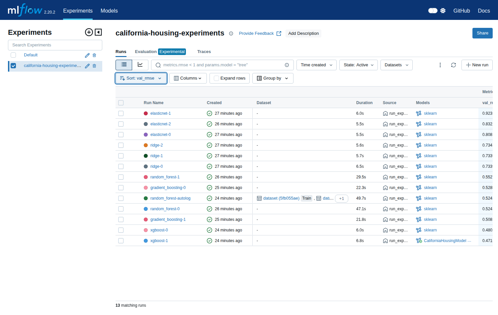
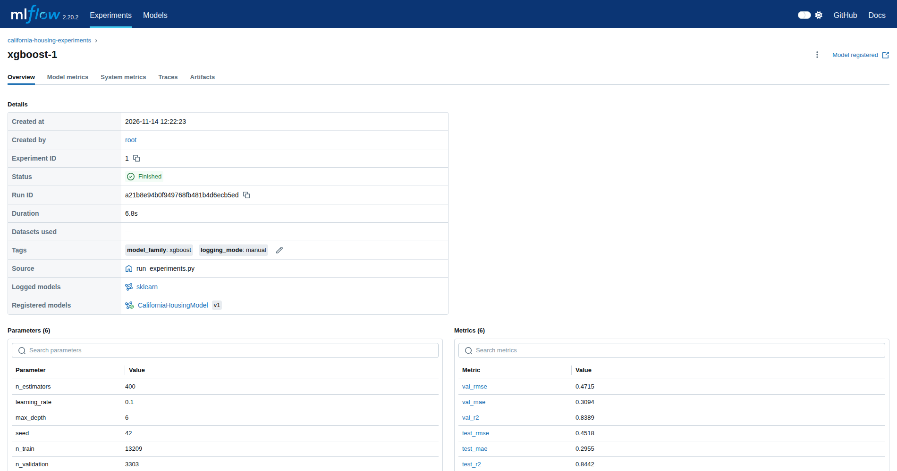
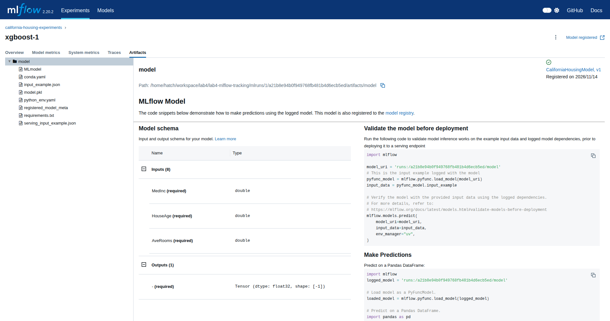
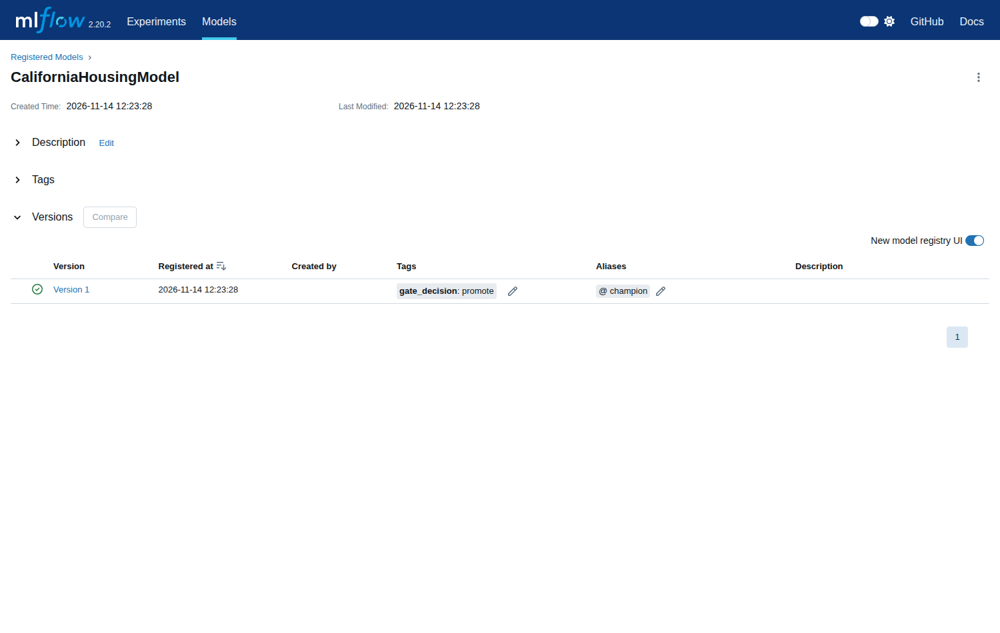

# Lab Assignment 4 - MLflow: Experiment Tracking and Model Registry

**Lab implemented:** the MLflow experiment-tracking lab
(`Labs/Experiment_Tracking_Labs/Mlflow_Labs/Lab1` in the course repo):
tracking experiments and runs, logging parameters, metrics and model
artifacts, autologging, model signatures, the model registry, and
loading a model back for predictions.

**Project:** an original experiment-tracking and model-registry
system for a regression problem - predicting median house value on
the California housing dataset (20,640 census block groups, 8
features). A designed grid of twelve model configurations is tracked
as MLflow runs. The best run **by validation RMSE** is registered as
a versioned model if it passes a promotion gate, the gate moves the
`champion` alias, a scoring stage loads the champion *from the
registry by alias* and scores it once on the test split, and a
serving stage starts the champion in MLflow's own model server and
checks its HTTP predictions against in-process ones. The full
lifecycle runs locally by hand and in CI when this folder changes.

## How the lab's modules map to this submission

| Course lab module (Mlflow_Lab1) | Where it is implemented here |
|---|---|
| Experiments and runs (course notes: an experiment groups runs; a run records params, metrics, artifacts, source) | One experiment, `california-housing-experiments`, holding 13 runs; every run records its hyperparameters, validation and test metrics, tags, and the fitted model as an artifact (`src/run_experiments.py`) |
| Tracking basics: tracking URI, `start_run`, `log_param` / `log_metric` | All runs use explicit `log_params` / `log_metrics`; the tracking URI is set in one shared place (`src/tracking.py`) |
| Storage mechanisms (course notes: local `mlruns/` file store vs a backend store / tracking server) | This project uses a **SQLite backend store** (`mlflow.db`) instead of the default file store - see "What differs from the lab demo" for why |
| Autologging (`autologging-intro`) | One run repeats a RandomForest configuration with `mlflow.sklearn.autolog()`, tagged `logging_mode=autolog`, next to the twelve manually logged runs |
| Comparing runs with different hyperparameters (the demo's alpha / l1_ratio runs) | A designed grid: 12 configurations across Ridge, ElasticNet, RandomForest, GradientBoosting, and XGBoost, exported through the search API to `reports/runs_table.csv`, ordered by validation RMSE |
| Logging a model with a signature (`infer_signature`, input example) | Every manually logged run stores its model with an inferred signature and an input example |
| Model registry (`registered_model_name`; the demo notes the registry does not work with a file store) | `src/register_and_promote.py` registers the best run as a new version of `CaliforniaHousingModel` in the registry that the backend store makes available - on a `promote` decision only (see the gate below) |
| Storing and loading a model (starter notebook: "Store ML models", "Load a model") | `src/score_with_champion.py` loads `models:/CaliforniaHousingModel@champion` with `mlflow.sklearn.load_model` and scores the test split |
| Serving (the course's serving material runs a local REST server for the model and posts rows to `/invocations`) | `src/serve_check.py` starts `mlflow models serve` for the champion (the alias URI `models:/CaliforniaHousingModel@champion` worked directly in MLflow 2.20.2; a resolved artifact path is the fallback), posts the first 20 test rows to `/invocations`, and asserts the responses match in-process predictions within 1e-6 |
| Viewing results (the demo opens the MLflow UI) | `mlflow ui --backend-store-uri sqlite:///mlflow.db` works locally after a run; screenshots from the UI are in `docs/` (see Results); CI exports the runs table and writes a summary to the Actions run page |

## What differs from the lab demo, and why

- **Backend store instead of the file store.** The demo's
  `linear_regression.py` registers the model only `if
  tracking_url_type_store != "file"` - with the default store the
  registry path silently never runs. Here the SQLite backend store
  makes registration, versioning, and aliases work end to end.
- **A designed experiment, not single runs.** The demo trains one
  ElasticNet per invocation and compares informally. Here the grid,
  the metrics, and the exported runs table make the comparison the
  deliverable.
- **Selection on validation, the test split used once.** Runs are
  fitted on the train split and log both validation and test
  metrics. The best-run choice and the promotion gate use
  **validation RMSE only**; the champion is then scored on the test
  split a single time as the unbiased estimate. (An earlier version
  of this project selected on test RMSE - see the comparison in
  Results.)
- **Registration is gated, not automatic - and a hold registers
  nothing.** The demo registers on log (when it can). Here the
  `champion` alias moves only if the candidate's validation RMSE
  beats the current champion's by a 1% relative margin. On `hold`
  the candidate stays an experiment run and **no new model version
  is created**; on `promote` the new version is tagged
  `gate_decision=promote`. Both decisions and the tracked metrics
  are recorded in `reports/promotion_report.json`.
- **A consumer that trusts the alias, plus a serving check.**
  Scoring never opens a local model file; it loads by registry
  alias, so whatever passed the gate is what gets scored - and
  `verify_outputs.py` checks the scored model's measured test RMSE
  against the tracked test RMSE of the run behind the alias. The
  serving stage then proves the same artifact answers over HTTP.
- **Re-runs are explicit.** The tracking database is a generated
  artifact, so `python -m src.run_experiments --fresh` deletes it
  (and `mlruns/`) before running, and the exported runs table again
  holds exactly the 13 runs of one execution. Without `--fresh`,
  runs append, as MLflow normally behaves.
- **A different problem and dataset** (California housing
  regression), with seeded, saved train/validation/test splits that
  every stage shares (64/16/20; the test rows are the same rows the
  earlier two-way split used, drawn first with the same seed).

## Results

Best run and champion, from the verified run whose outputs are in
`sample_output/`:

| | Value |
|---|---|
| Best run (by validation RMSE) | XGBoost, `n_estimators=400, learning_rate=0.1, max_depth=6` |
| Validation RMSE / MAE / R2 | 0.4715 / 0.3094 / 0.8389 |
| Gate on first registration call | `promote` - champion version 1 |
| Gate on a repeat call (same experiment) | `hold` - no new version created |
| Champion test RMSE / MAE / R2 (scored once) | 0.4518 / 0.2955 / 0.8442 (`n_test` 4,128) |
| Serving check | `pass` - HTTP predictions identical to in-process (max difference 0.0, tolerance 1e-6), served via the alias URI |

What changed when selection moved from the test split to the
validation split:

| | Previous version | This version |
|---|---|---|
| Selection metric | test RMSE | validation RMSE |
| Champion configuration | XGBoost, max_depth 6 | XGBoost, max_depth 6 - **unchanged** |
| Selection score | 0.4518 (test) | 0.4715 (validation) |
| Test RMSE | 0.4518 (was the selection score) | 0.4518 (measured once, after selection) |
| Test MAE | 0.291 | 0.2955 |

The champion configuration did not change; the model itself is
retrained on the smaller train split, which is why the test MAE
moved slightly while the test RMSE rounds to the same value.

Screenshots (MLflow UI against the same local store, and the CI run
summary):


*The 13 runs of `california-housing-experiments`, sorted by val_rmse (the table's Sort control reads `val_rmse`); the lowest value, xgboost-1 at 0.4715, is the bottom row.*


*The best run, xgboost-1: parameters (n_estimators 400, learning_rate 0.1, max_depth 6, seed 42, split sizes) and all six metrics - validation and test.*


*The run's logged model artifacts and the model schema (signature): 8 double inputs, one float32 tensor output.*


*`CaliforniaHousingModel` in the registry: version 1 carries the tag `gate_decision=promote` and the `@champion` alias.*

The fourth view is not a file here: the summary GitHub Actions
writes for every Lab 4 CI run (produced by `summarize_run.py`; the
current pipeline's summary additionally prints the serving-check
line). See, for example, run #2 on main:
https://github.com/SarrangTech/MLops_assignments/actions/runs/43613681754

## Layout

| Path | Purpose |
|---|---|
| `src/data_pipeline.py` | Fetches California housing; writes the seeded splits to `data/train.csv` / `data/validation.csv` / `data/test.csv`; reads them back for every stage |
| `src/tracking.py` | Shared configuration: tracking URI (SQLite backend store), experiment and model names, the primary metric (`val_rmse`), metric computation, tracking-store reset for `--fresh` |
| `src/run_experiments.py` | The 12-configuration grid + 1 autologging run; logs validation and test metrics; exports `reports/runs_table.csv` ordered by validation RMSE; `--fresh` restarts the store |
| `src/register_and_promote.py` | Promotion gate on validation RMSE; registers the best run only on `promote`; writes `reports/promotion_report.json` |
| `src/score_with_champion.py` | Loads the champion by alias, scores the test split once; writes `reports/champion_metrics.json` and `reports/predictions.csv` |
| `src/serve_check.py` | Serves the champion with `mlflow models serve`, posts test rows to `/invocations`, compares against in-process predictions; writes `reports/serve_check.json` |
| `tests/test_tracking.py` | Pytest suite on temporary tracking stores: tracking contract, gate promote/hold (a hold creates no version), scoring round-trip, re-running with `--fresh`, and the serving check against a real server (`tests/conftest.py` puts the project root on the import path so the suite also runs from the repository root, as CI invokes it) |
| `verify_outputs.py` | Post-run smoke check used locally and as a CI step |
| `summarize_run.py` | Renders the experiment + registry results as Markdown (CI run summary) |
| `requirements.txt` | Pinned dependencies (MLflow, scikit-learn, XGBoost, pandas, pytest) |
| `data/README.md` | What the generated split files are |
| `docs/` | MLflow UI and CI screenshots referenced from Results |
| `sample_output/` | One verified local run, all stages: `experiments.log` (the full pipeline, stdout and stderr), `runs_table.csv`, `promotion_report.json` (promote), `promotion_report_hold.json` (the repeat call), `champion_metrics.json`, `serve_check.json` |

## Requirements

- Python 3.11 or 3.12 (CI tests both)
- Dependencies are pinned in `requirements.txt`
- No accounts or external services: MLflow tracks to a local SQLite
  file; the dataset downloads once from scikit-learn's cache source

## Run it locally

```bash
git clone https://github.com/SarrangTech/MLops_assignments.git
cd MLops_assignments
python -m venv .venv
source .venv/bin/activate          # Windows: .venv\Scripts\activate
pip install -r lab4-mlflow-tracking/requirements.txt
cd lab4-mlflow-tracking

python -m pytest tests -q
# 5 passed

python -m src.run_experiments --fresh
# 13 runs tracked (12 manual grid + 1 autolog); writes reports/runs_table.csv
# (--fresh deletes the generated mlflow.db / mlruns first; without it, runs append)

python -m src.register_and_promote
# gate on validation RMSE: on promote, registers the best run as a new
# version and moves the champion alias; on hold, registers nothing

python -m src.score_with_champion
# loads models:/CaliforniaHousingModel@champion and scores the test split

python -m src.serve_check
# serves the champion over HTTP and compares predictions

python verify_outputs.py
python summarize_run.py            # the summary CI puts on the run page

mlflow ui --backend-store-uri sqlite:///mlflow.db
# optional: browse the experiment and the registry in the MLflow UI
```

## What a successful run looks like

Locally: pytest reports `5 passed`; the experiment stage prints one
line per configuration with its validation and test RMSE and exports
a 13-row runs table ordered by validation RMSE; the registry stage
prints a promotion report (decision, candidate and champion
validation RMSE, margin); scoring prints the champion's test
metrics; the serving stage prints `pass` with the maximum prediction
difference; `verify_outputs.py` prints `Smoke check passed`.

In CI (Actions tab - **Lab 4 CI**): the workflow runs when files
under `lab4-mlflow-tracking/` or the workflow itself change (plus
manual dispatch and a weekly run). Four jobs - `lint-and-test` and
`experiments-and-registry`, each on Python 3.11 and 3.12. The
experiments job runs the same stages as above, including the
serving check. The run summary shows the best run, the gate
decision, the champion metrics, and the serving result; the
`lab4-experiment-py<version>` artifact holds the runs table, the
promotion report, the champion metrics, the serve check, and the
predictions.

## Verification

| Check | Date | Revision | Result |
|---|---|---|---|
| Local run of every command above in a clean venv built from `requirements.txt` (Python 3.12) | 2026-11-14 | this branch's working tree | Lint clean; pytest 5 passed; 13 runs tracked (13,209 / 3,303 / 4,128 splits); best run XGBoost (max_depth 6) at validation RMSE 0.4715; gate `promote` (champion version 1), repeat call `hold` with no new version; champion scored by alias at test RMSE 0.4518; serving check passed (max difference 0.0 via the alias URI); smoke check passed. Full log and outputs in `sample_output/` |
| Clean clone of this branch, fresh venv from `requirements.txt`, commands run as a checker would (pytest invoked from the repository root, as CI does) | 2026-11-14 | 59340bc (branch head when cloned; the only later commit is this README) | Lint clean; pytest 5 passed; the pipeline reproduced the local results exactly - gate `promote` at validation RMSE 0.4715, champion version 1, champion test RMSE 0.4518 / MAE 0.2955 / R2 0.8442, serving check passed (max difference 0.0 via the alias URI); smoke check passed |
